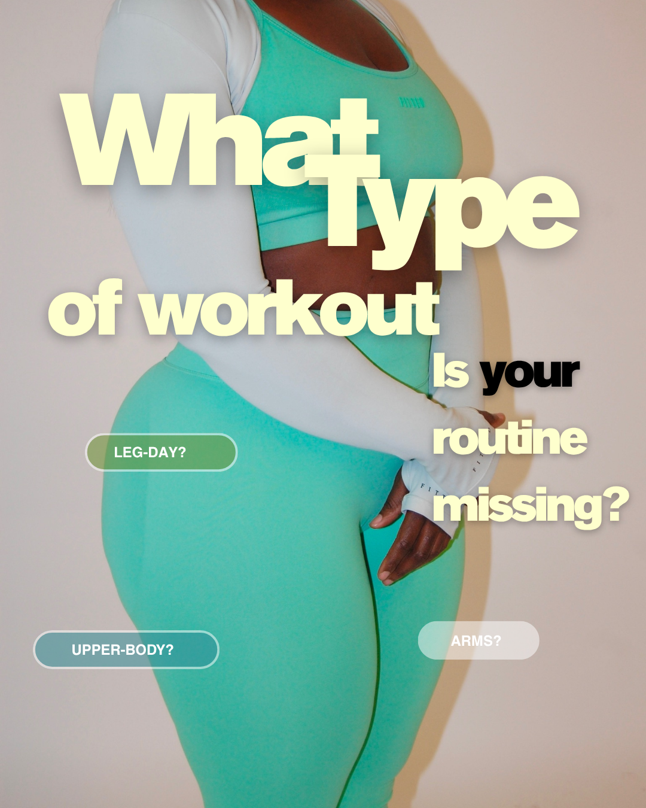
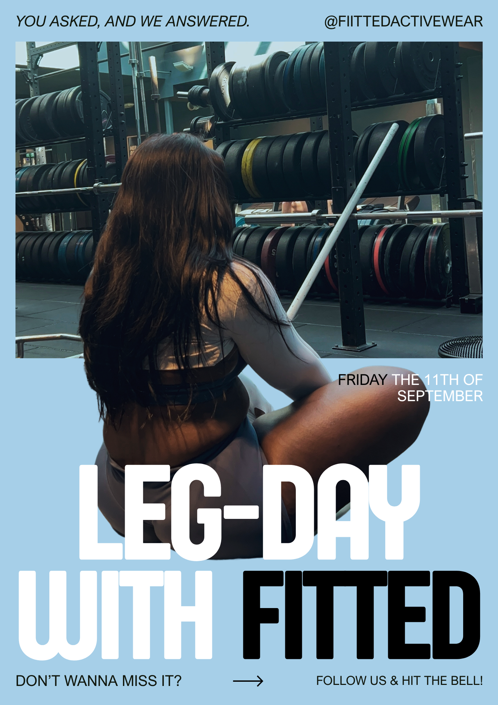
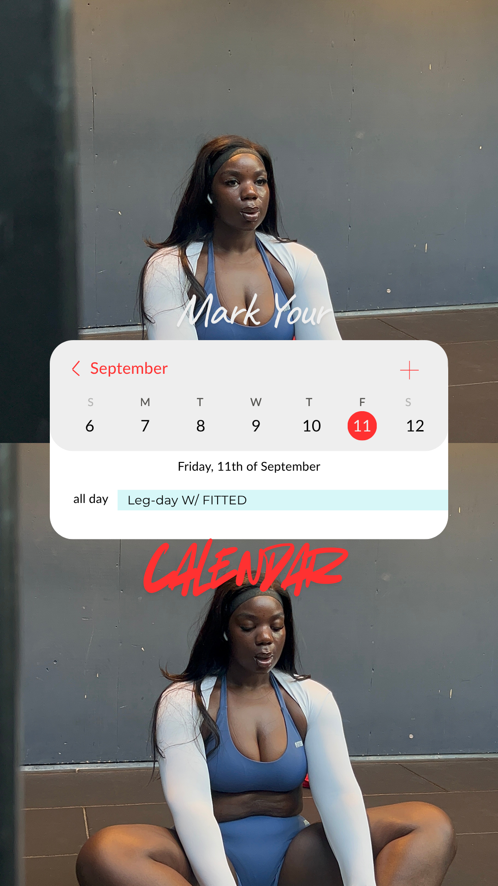
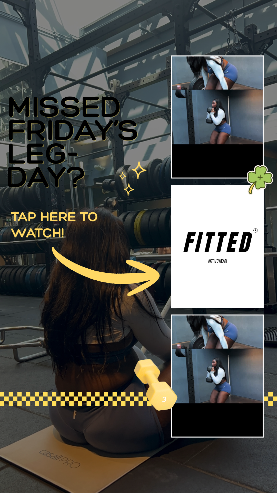
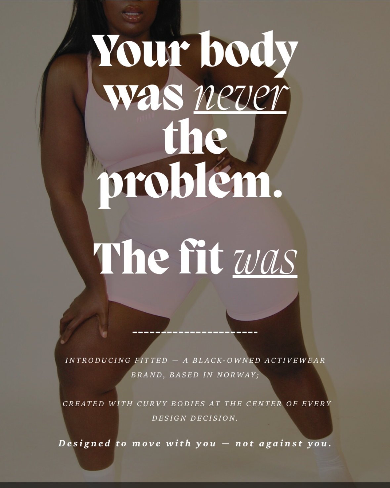
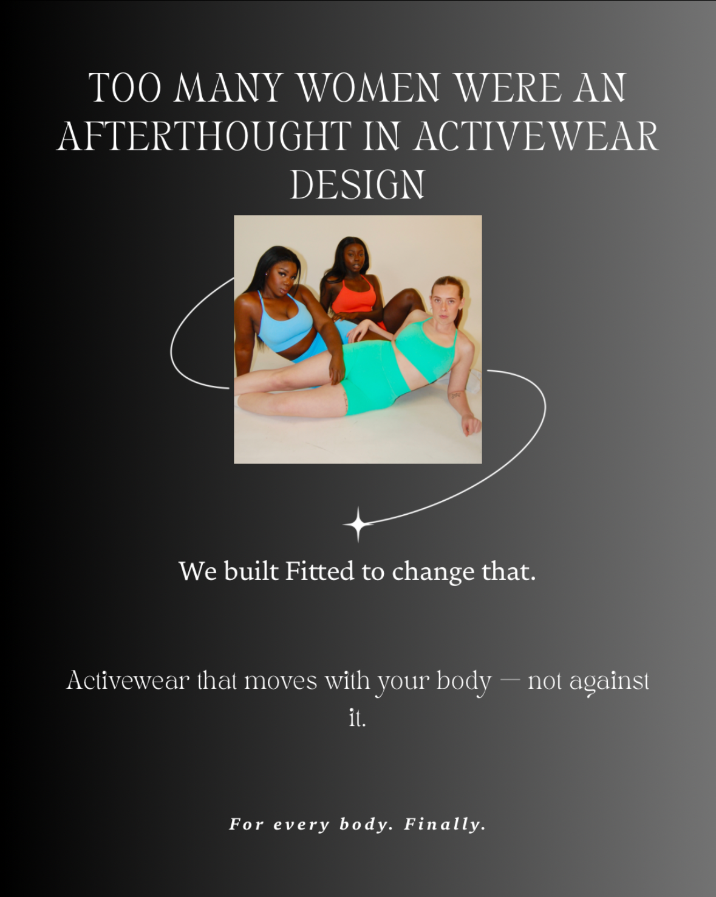
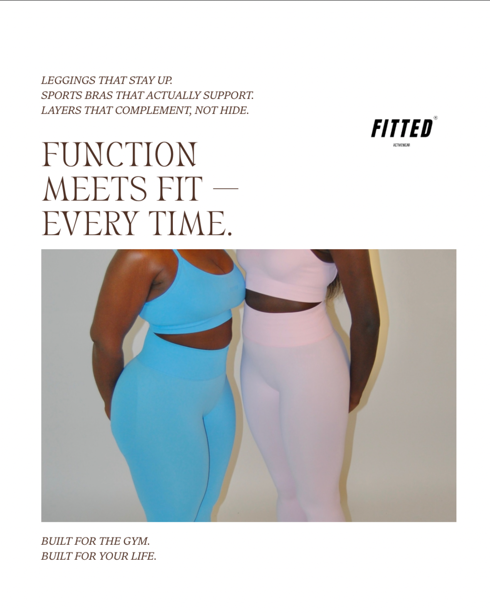
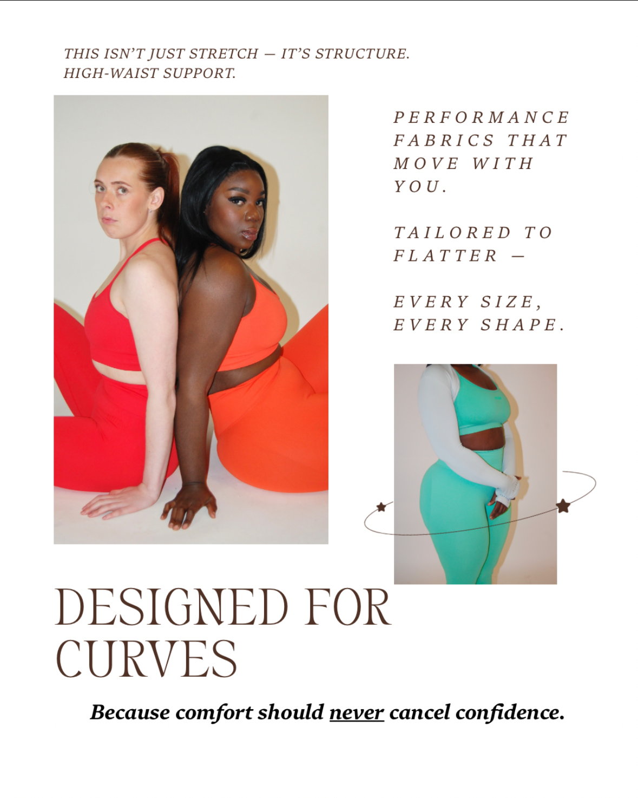
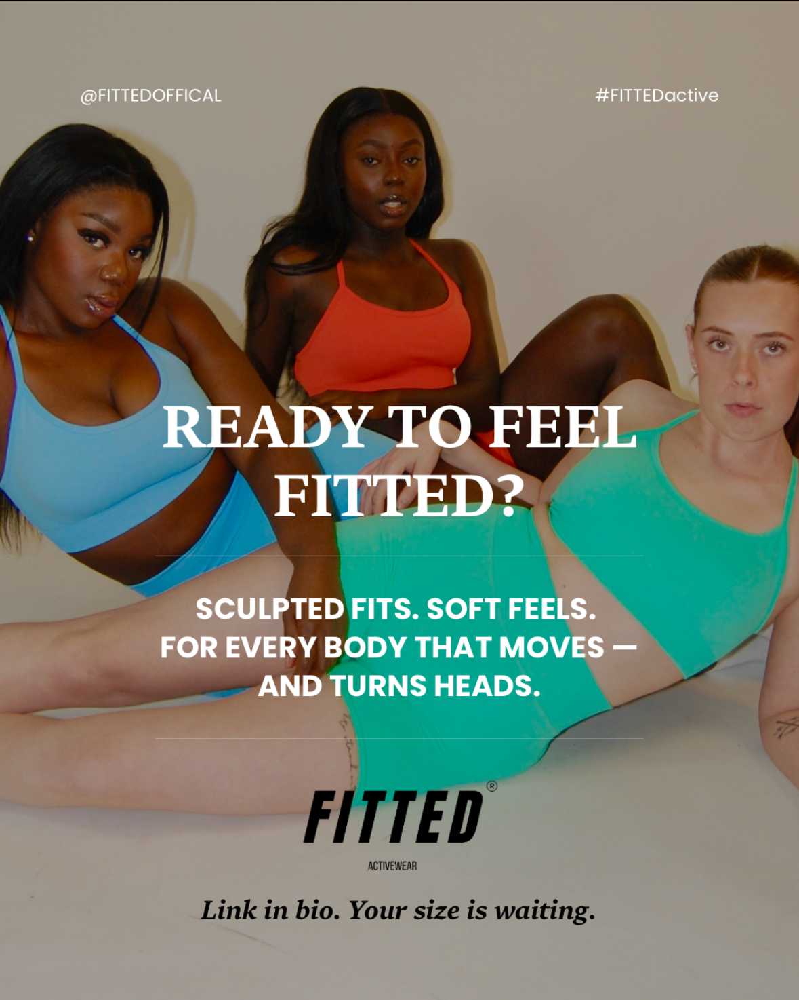

[← Back to portfolio](https://github.com/BettyjannehDigital)

# Project Exam Campaign – FITTED Activewear

**Project Exam | Noroff Digital Marketing | Sept 2026**  
**Client:** FITTED — women's activewear brand, Oslo | **Platform:** Instagram (Stories + Reel)  
**Tactics:** Social media marketing, content marketing

---

## Overview

FITTED is a women's activewear brand built for bodies outside the "standard" Scandinavian build. Its Instagram Reels already outperform other formats, but posting is irregular. I planned and ran a **5-piece Instagram series** around one leg-day workout video: three Stories to build anticipation, the main Reel, and a recap Story to send people back to it.

This was a real campaign on the client's live account, measured with Instagram Insights.

---

## Objective

> Increase FITTED's Instagram engagement rate by 20% across the 3-week campaign period (7–27 September 2026), compared with the previous 4 weeks, by publishing a structured 5-part content series.

---

## The Campaign

| # | Piece | Format | Posted | Purpose |
| --- | --- | --- | --- | --- |
| 1 | "What workout are you looking for?" | Story, Questions sticker | Mon 7 Sept, 3 PM | Gather real audience input before launch |
| 2 | "You Asked, We Answered" | Story | Wed 9 Sept, 12 PM | Confirm the direction and announce the date |
| 3 | "Mark Your Calendar" | Story | Thu 10 Sept, 6 PM | Reminder closer to the date |
| 4 | Leg-day workout video | Reel | Fri 11 Sept, 3 PM | Core campaign content |
| 5 | "Missed Friday's Leg-Day?" | Story | Sun 13 Sept, 7 PM | Close the loop, drive traffic back to the Reel |

Choices behind the plan:

- **Questions sticker instead of a Poll:** the video was already filmed, so a poll result that didn't match it would have left no time to reshoot. Open answers removed that risk and still gave a real engagement signal.
- **Posting times chosen on purpose:** lunch and evening slots on weekdays, an earlier Friday slot because the audience is less active later on Fridays, and a Sunday evening recap for a "don't miss out" effect, with a black and yellow palette to stand apart from the softer mint and blue pieces.
- **Client posting guide:** the client posted from my written guide, so I rewrote the recap Story steps after she asked what steps two and three meant, then added a screen recording, a narrated recording and a reference screenshot.

---

## Brand Story Carousel

A separate 5-slide carousel post for FITTED, telling the brand story from the problem ("your body was never the problem, the fit was") through the product to a call to action.

---

## Results

| Metric | Baseline (3 Jul – 6 Sept) | Campaign (7–13 Sept) |
| --- | --- | --- |
| Total views | 40,616 | 3,406 (5 pieces) |
| Total interactions | 1,109 | 81 |
| Interaction rate (interactions ÷ views) | ≈ 2.7% | ≈ 2.4% |
| Non-follower reach | 63.2% (all Reels) | 62.3% (main Reel) |
| Net new followers | +7 (about 9.5 weeks) | 0 (1 week; 28 profile visits from the Reel) |

**The 20% engagement target was not met.** The interaction rate dipped slightly, from about 2.7% to about 2.4%. The baseline covers about 9.5 weeks and the campaign data one week, so the two aren't a like-for-like comparison, and the 20% target was set before any real baseline data existed.

**What the data did show:**

- The main Reel reached **1,078 viewers**, and **62.3% were non-followers**.
- **71.8% of the Reel's views** came from people tapping through from the earlier Stories, so the Story-to-Reel funnel worked.
- The Reel drove 28 profile visits but no new followers, so reach alone didn't convert.

---

## What I Learned

- Set the SMART objective only after real baseline data is available.
- Pick the metric that matches the actual goal. Here, non-follower reach and Story-to-Reel conversion would have been better primary metrics than raw engagement rate.
- A text-only guide isn't enough for a fiddly visual action. Client instructions should be video-first.
- Test a design with the real video before finalising it, so it fits the platform's 9:16 Story format.

---

## Videos & Raw Files

Videos are too large for GitHub, so they live in Google Drive:

🎬 [Watch the campaign videos](https://drive.google.com/drive/folders/1e7rsg2AH8I-0joCq3TUXDQz5vOefdTK-)

---

## Tools Used

`Instagram Insights` `Canva` `CapCut`

## Brand

🔗 [fitted.no](https://www.fitted.no) · 📱 [@fiittedactivewear](https://www.instagram.com/fiittedactivewear)

## Related Projects

- [Freelance – FITTED Activewear](https://github.com/BettyjannehDigital/Freelance-FITTED-Activewear) (transitional video, 2025)
- [Social Media Marketing – OneOhOne Jewelry](https://github.com/BettyjannehDigital/SoMe--Marketing-OneOhOne)
